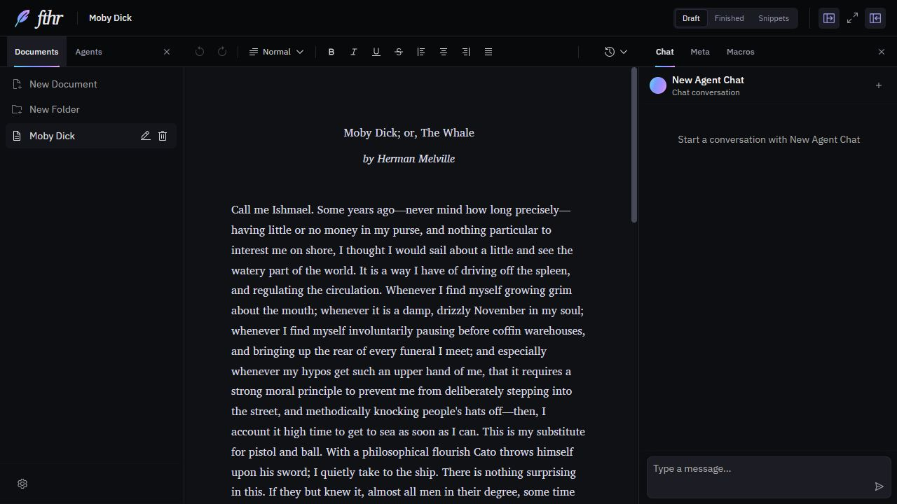

<div align="center">
  <h1>
    <picture>
      <source media="(prefers-color-scheme: dark)" srcset="docs/assets/fthr-logo-dark.svg" />
      
    </picture>
  </h1>
  <p><strong>Customize your own writing workspace</strong></p>
  <p>
    <a href="https://fthr.vercel.app/">
      
    </a>
  </p>
  <p>
    <a href="https://github.com/darrylschaefer/ai-text-editor/issues/new/choose">Report a bug</a> ·
    <a href="CONTRIBUTING.md">Contribute</a>
  </p>
</div>

[](https://fthr.vercel.app/)

fthr is a customizable word processor that brings your documents, AI agents, and reusable macros into one workspace. It runs in your browser, giving you a place to write, organize, and revise your work.

Send selected passages directly to AI, build prompts that draw on your notes and document metadata, and configure agents with your own instructions and model settings. Save macros for the writing and editing tasks you repeat, from developing ideas to revising a draft.

Keep your documents local in your browser, and connect your own API key for AI assistance. AI requests send the relevant text and context to your configured provider.

## Features

| Feature | What you can do |
| --- | --- |
| Instant macros and selection sending | Run saved prompts against a selected passage, with individual model settings for each macro. |
| AI agents with document tools | Configure agents with your own instructions and model settings, with tools for reading, searching, and editing documents. |
| Context-aware prompts | Include selected text, named notes, and document metadata in your prompts, using references that pull in the relevant content. |
| Writing versions and notes | Create, copy, rename, and switch between writing versions within a document, with shared notes in the right sidebar. Organize documents into folders. |
| Custom document metadata | Keep tags, descriptions, and custom fields with a document, and reference those fields in AI prompts. |
| Semantic and hybrid search | Search by keyword, by meaning through embeddings, or combine both approaches to retrieve relevant passages. Embedding search requires configuration. |
| Checkpoints and version diffs | Save named checkpoints in the History sidebar, preview saved text, and compare it with your current writing. |

## Try it

Open **[fthr.vercel.app](https://fthr.vercel.app/)** to start writing. You can dismiss the API-key prompt to use the editor without AI.

To use AI, open the library pane's **Workspace settings → API** and enter your key. Agent and embedding options are available in the same settings menu. API usage is billed by your configured provider.

## Your writing and data

Documents, preferences, and your API key are stored in your browser, primarily through IndexedDB. They belong to that site's browser profile; opening another browser, device, or local installation does not automatically bring them across.

AI features send relevant text and context to the configured API provider. Embedding requests also send text when enabled. Local storage does not mean AI processing stays on your device.

Use **Workspace settings → Import / Export** to download a JSON export regularly, especially before clearing site data or changing browsers. The current export includes documents, folders, prompts, and the default chat configuration. Separate agent conversations and checkpoint history are **not included**, so it is not a complete workspace backup.

## Run locally

Use **Node.js 24.15.0 or newer within 24.x** and **npm 11.19.0**. The repository checks supported versions during installation.

```bash
git clone https://github.com/darrylschaefer/ai-text-editor.git
cd ai-text-editor
npm ci
npm run dev
```

Open [localhost:5173](http://localhost:5173/). An API key is needed for AI features, not for local editing or the automated test suite.

No environment file is required for the default setup. Optional configuration is listed in [.env.example](.env.example). `VITE_*` values are included in the browser build; use the in-app API setting for a personal key rather than embedding it in a public deployment.

## Development

| Command | Purpose |
| --- | --- |
| `npm run dev` | Start the development server. |
| `npm run check` | Type-check the application and tests, run the test suite, and build the web app. |
| `npm run test:watch` | Run tests while making changes. |
| `npm run build` | Create the production web build in `dist/`. |
| `npm run preview` | Serve the production build locally after building it. |

Pull requests and updates to `main` run validation on Linux and Windows. The Linux job also builds the web Docker image. See [CONTRIBUTING.md](CONTRIBUTING.md) for the branch/PR workflow, individual checks, Docker, and desktop development notes.

## Project status

fthr is actively developed. Persistence recovery, complete backups, and AI editing safeguards remain areas of ongoing work. Native desktop packaging is not covered by the web validation checks.

Found a problem or have an idea? [Open an issue](https://github.com/darrylschaefer/ai-text-editor/issues/new/choose). The [engineering backlog](docs/engineering-backlog.md) records known follow-ups.

## License and credits

Built by Darryl Schaefer. Released under the [MIT License](LICENSE).

Inspired by and adapted from BetterChatGPT, whose original work is released under CC0.
