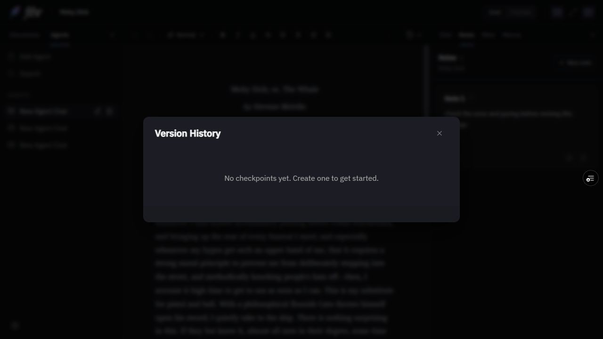
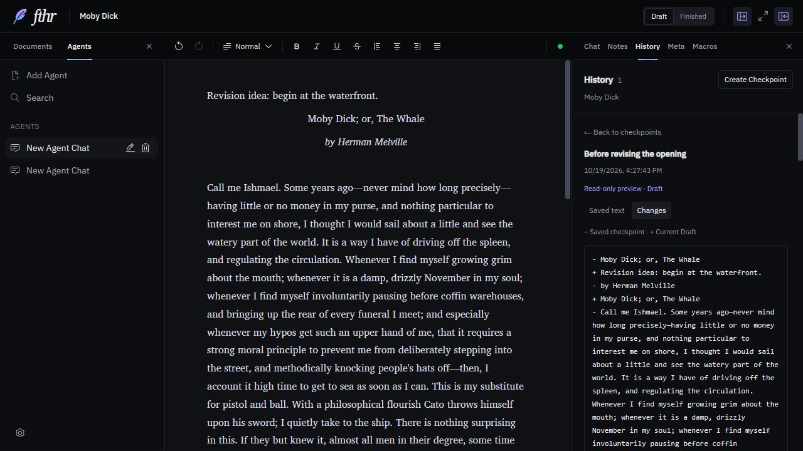
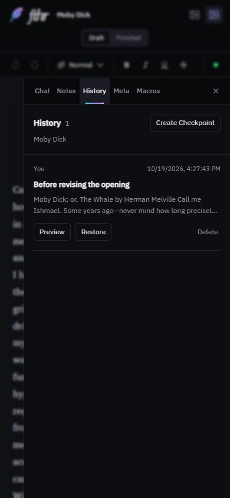

# History in the right sidebar

Issue [#23](https://github.com/darrylschaefer/fthr/issues/23). History joins Chat, Notes, Meta, and Macros. Named editable document versions remain separate work in #15.

## Behavior

- Opening History leaves the current manuscript and formatting toolbar mounted. It lists this document's existing checkpoints, newest first, with a name, date, author, and section excerpt.
- Checkpoint creation lives in History. It captures the active editor, flushes autosave, and preserves the existing full-document snapshot format. Duplicate submissions and stale submissions after cancellation or a document/section switch are guarded.
- The editor toolbar contains only the save-status dot: amber while content is pending or saving, green when saved (including the loaded idle state), and a red retry dot on a reported autosave failure. Accessible labels and hover text describe each state. Text selection, caret movement, and focus changes do not schedule autosave or change the dot.
- Preview offers read-only saved text and the existing plain-text line comparison for the active Draft or Finished section. It reads live editor updates, including typing before the autosave delay expires. Back to checkpoints returns focus to the original Preview button. The main editor always shows current writing.
- Restore explicitly confirms that it replaces Draft, Finished, all Notes, and document metadata, including title, description, tags, folder, and custom fields. It also clears editor undo history, as before. This is full-document recovery, even when previewing only one section.
- A document/section change during asynchronous restoration cancels it. A checkpoint belonging to another document is rejected. Delete requires confirmation and deletes only the checkpoint, leaving current writing untouched.
- Switching documents or sections resets the preview to the correct checkpoint list. Slow results from a previous document are ignored. Newly created user/AI checkpoints refresh the open list. Failed loads can be retried.
- Tabs fit a 280-pixel desktop sidebar and use the existing phone drawer, close/reopen behavior, keyboard focus management, and pane resizing.

## Compatibility and recovery

IndexedDB keys, checkpoint IDs, snapshot fields, note IDs, and macro/tool identifiers are unchanged. No data migration is required. A transient checkpoint counter refreshes the UI and is excluded from the existing explicit persisted-state list.

Restore keeps the previous full-document behavior; it does not create a named version or an automatic recovery checkpoint. Make a checkpoint of current work before restoring if you want to retain it. Existing JSON exports still exclude separate checkpoint records.

Reverting this PR returns to the previous modal/dropdown and save-status display. Existing checkpoints remain readable in either interface.

## Validation

Local `npm run check` validates app/test TypeScript, all 242 tests in 12 files, and the production build. GitHub CI results are recorded on the PR.

Integration tests use the real Workspace, Lexical manuscript, checkpoint/store actions, and sidebar. Durable storage and unrelated provider/indexing services are replaced with synthetic fixtures. Coverage includes:

- Legacy checkpoint listing, creation, refresh, read-only preview, and live diffs without replacing writing or its owned selection.
- Document/section switching, stale loads, empty/no-document states, load retry, pane close/reopen, and compact drawer behavior.
- Exact full-document restoration scope, confirmation cancellation/focus, delete cancellation/confirmation, restore failure, and cancellation during asynchronous document/section changes.
- Checkpoint flushing, duplicate submission prevention, and stale creation guards after moving creation into History.
- Green/amber/red status behavior, immediate pending status, retry, and selection/caret/focus changes preserving saved, pending, and failed states.

Browser checks on an isolated localhost origin use the bundled sample manuscript and a synthetic checkpoint. They cover creation, saved-text/changes previews, cancellation and focus return, Draft/Finished switching, pane close/reopen, minimum desktop width, and the 390 × 844 phone drawer with nested-dialog Escape handling. Native selection remains green while retaining the gray highlight on focus change; typing immediately turns amber and autosave returns green. The temporary test text was undone.

Browser restoration/deletion is not performed against user documents. Full restore/delete paths use synthetic integration fixtures. Packaged Electron, actual touch input, other browser engines, and exhaustive storage-failure/backup paths remain untested. Production rollout is deferred at the owner's request. Existing dependency/chunk-size warnings are unchanged.

## Screenshots

Before: History covers the workspace in a modal.

After: read-only comparison beside the current writing, with the save dot in the toolbar.

