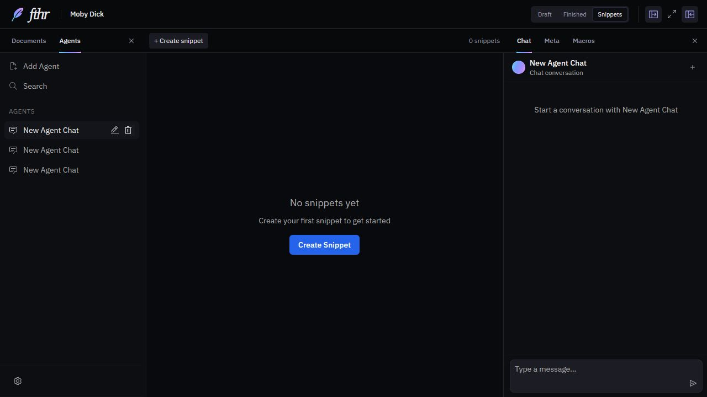
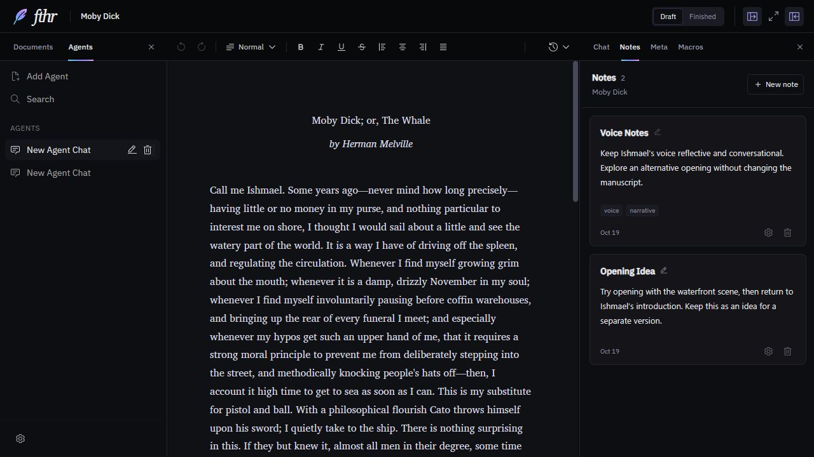
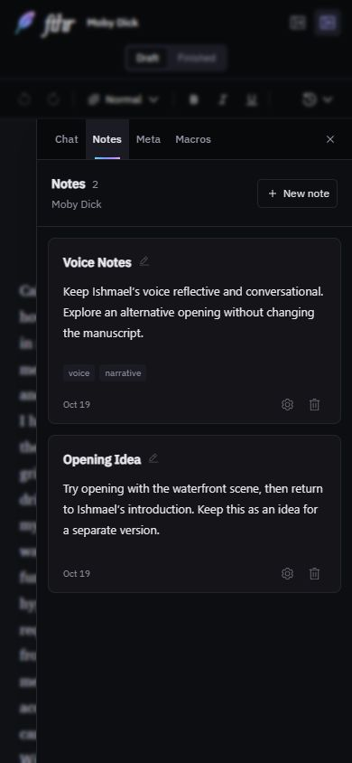

# Notes in the right sidebar

Issue [#14](https://github.com/darrylschaefer/fthr/issues/14). This change renames the Snippets interface to Notes and moves it beside the manuscript. Named document versions (#15) and sidebar History (#23) remain separate work.

## Behavior and compatibility

- Notes appears beside Chat, Meta, and Macros in the right sidebar. The main section controls contain Draft and Finished only; opening Notes leaves the current manuscript editor and formatting toolbar mounted.
- Notes belong to the parent document and are shared between its Draft and Finished sections. Existing rich text, names, IDs, tags, configuration, ordering, and timestamps are retained. New notes created through the sidebar receive available note1, note2, etc. names.
- Note cards use a softer surface, readable titles, compact body text, and quieter tags/date/actions below the writing. Readable titles are display formatting only: voiceNotes still uses the exact voiceNotes name in existing macro references.
- The storage field remains snippets. Existing snippet macro syntax and tool IDs are unchanged. Renaming a note still changes its reference name, as before.
- Legacy callers requesting the Snippets section open the Notes sidebar without changing the current writing section or its valid selection. Requests use transient state and follow the workspace's desktop/phone pane policy.
- A document saved with currentVersion set to Snippets opens Notes beside Draft. Both saved writing copies and all notes remain intact. No new data format or destructive conversion is introduced.
- Note editors reflect external updates to their saved rich text. Switching documents remounts the corresponding note editors and closes their settings dialogs.
- The existing history/checkpoint menu and its full-document restore behavior are unchanged.

## Verification

Local npm run check passed: application/test TypeScript checks, all 229 tests in 11 files, and the production build. GitHub CI results are recorded on the PR separately.

The new integration suite mounts the real workspace, manuscript, Notes editors, document actions, and legacy macro/tool readers. It uses synthetic documents and replaces durable storage, provider execution, indexing, and unrelated sidebar views. It covers:

- Existing note order, rich-text formatting, and opening without rewriting saved notes.
- Creating/editing notes independently of Draft/Finished, tab changes, pane close/reopen, and reconstruction from saved JSON.
- Retained manuscript selection while editing a note and while handling a legacy Snippets request.
- Existing macro references and snippet tool reads.
- Rename/configuration, external content updates, document switching, deletion cancellation/confirmation, and the no-document state.
- Legacy saved navigation and programmatic opening on desktop and compact layouts without changing phone users' desktop pane preferences.

Existing toolbar/selection regressions now assert that Notes navigation preserves the manuscript instead of replacing it. The toolbar fixture waits for the existing autosave idle timers before its DOM environment is torn down.

Browser review uses the bundled sample manuscript and disposable notes on an isolated localhost origin. Desktop checks include note creation, editing, naming, metadata, native selection retention, a 280-pixel sidebar, and dialog Escape/focus restoration. The 390 x 844 phone drawer fits without horizontal page overflow, and closing it restores the writing view.

## Screenshots

Before: Snippets replaces the manuscript.

After: Notes sits beside the manuscript.

## Limits and rollback

Synthetic JSON reconstruction checks compatibility but does not certify every import/export, disk-failure, or backup path. Paid AI requests, packaged Electron, actual touch input, and other browser engines are not exercised. Existing dependency warnings remain outside this change.

Reverting the PR restores the previous navigation because saved note data, IDs, references, and schema are unchanged. A saved legacy Snippets view is normalized to Draft when encountered; the previous code can still read that value and all note content.
