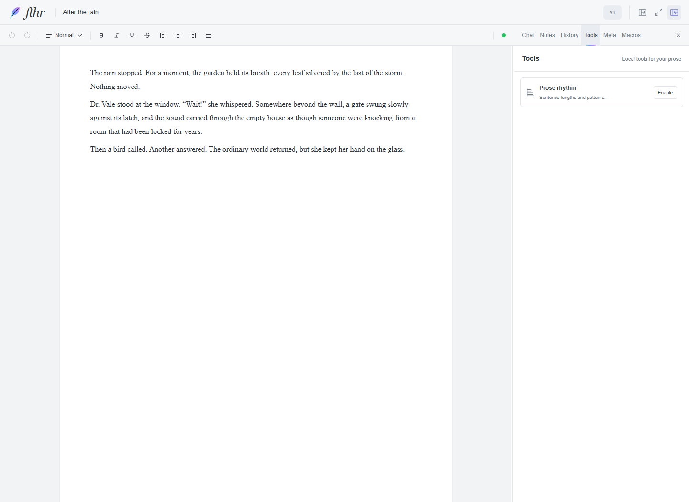
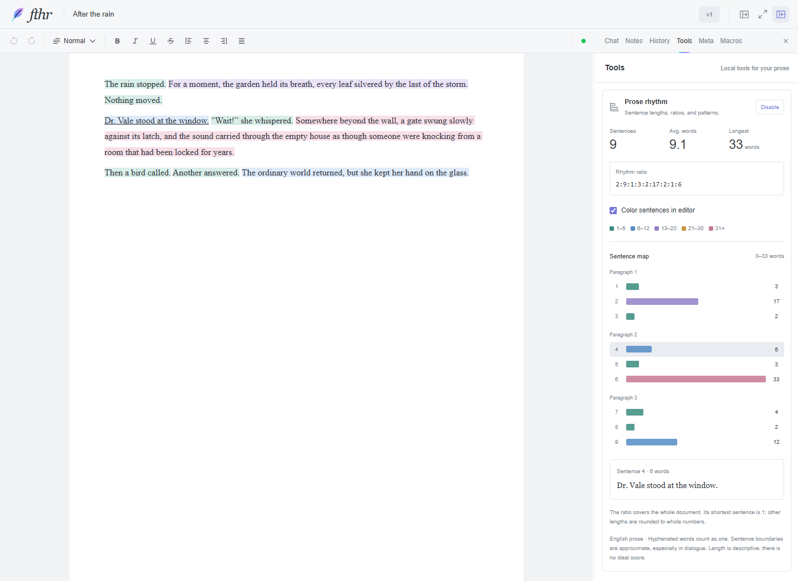

# Prose Rhythm preview

Open the right panel and choose **Tools**, then **Enable** on the Prose rhythm card. Tools starts as a compact list with analysis and coloring off. Enabling a tool is temporary for this workspace session; reloading starts it off again. **Disable** removes its colors and collapses its results. Closing the panel or changing tabs pauses it.

The map groups sentences by paragraph. Each bar shows its word count; hover or focus to read a sentence, and click to scroll to it without replacing a text selection. The five colors represent 1–5, 6–12, 13–20, 21–30, and 31+ words. The longest sentence sets the shared chart scale. Long maps have pages of 80 sentences.

Each paragraph also shows a **Rhythm ratio**: divide each sentence's word count by that paragraph's shortest sentence, then round to whole numbers. For example, `8, 8, 8, 16, 16, 8` words becomes **1:1:1:2:2:1**. Ratios describe relative lengths; they do not rate the prose.

This initial version analyzes English prose with local sentence and word segmentation plus rules for common titles, initials, dialogue tags, and lowercase sentence openings. Contractions and hyphenated compounds count as one word; numbers count as word-like items. Soft breaks remain within sentences; hard paragraph boundaries stay separate. Headings, code, and tables are excluded. Unpunctuated endings appear as unfinished sentences. Boundaries remain approximate for ambiguous dialogue, abbreviations, and unusual punctuation.

The tool reads the current Lexical state and paints browser ranges with CSS Custom Highlights. It does not write sentence colors or analysis into the document, export, history, or undo stack. Retained selection takes precedence over rhythm colors. A browser without custom highlights still gets the map. Sentence segmentation support is required.

This prototype does not add agent tools or change agent access. It relates to [Tools issue #18](https://github.com/darrylschaefer/fthr/issues/18) as the first local writing tool; agent exposure controls remain separate work.

## Previews

All text in these screenshots is synthetic.

Default Tools list:

Enabled, light theme:

[Dark theme](previews/prose-rhythm-dark.png) · [Phone layout](previews/prose-rhythm-phone.png)

## Verification

Unit and integration tests cover the stated sentence conventions, exact Lexical mappings across styles and links, repeated text, Unicode, soft breaks, nested lists, cache refresh after formatting, default-off behavior, enable/disable, whole-number ratios, version/document changes, retained selection, IME event handling, and highlight cleanup/fallback. They use synthetic documents and in-memory storage.

Chrome browser checks cover the default compact menu, visible colors and ratios in light/dark themes, color toggling, bar focus/click, unchanged serialized content, native keyboard selection retained on panel focus, live typing, and a 390px phone drawer without horizontal page overflow.

Other browser engines, the packaged Electron renderer, physical IME entry, and book-length performance have not been verified. The chart is paged and sentence segmentation is cached per prose block, but the prototype still reads the active document and refreshes highlight ranges after content/format changes.
