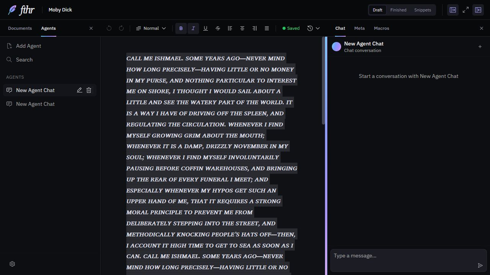

# Selected text and its inactive highlight

Issue: [#13](https://github.com/darrylschaefer/fthr/issues/13). Verified locally October 19, 2026.

## Behavior

The active editor uses the browser's ordinary selection. Moving focus to chat, macros, or another control keeps a valid passage available and shows a quiet gray background. Returning to the editor removes the custom background so native selection can take over.

Selection context is transient and owned by a particular editor, document, and section. It contains exact endpoints, text positions, the selected text, and the document text used to validate it. It is excluded from persisted state. Macros, selection sending, and selection-reading tools resolve that context instead of using an unowned string.

Document or section changes, editor disposal, explicit deselection, and text changes while the editor is inactive clear the context and background. Invalidation is deliberately conservative: an inactive edit elsewhere in the same document also clears the remembered selection. Formatting may carry a range forward only when its text and both absolute positions remain unchanged.

## Highlight rendering

The first prototype used the CSS Custom Highlight API. Its font-sized backgrounds left visible gaps between wrapped lines, particularly in bold italic Charis SIL. The retained highlight now merges selected text fragments into line-height bands and paints opaque background layers on the containing blocks. Adjoining wrapped lines share an edge; real paragraph spacing stays intact.

Painting behind the text avoids tinting glyphs or intercepting input. Backgrounds move and clip with the document rather than floating above the page. Resize, font-loading, and theme changes update geometry or color; cleanup restores the original inline background properties and removes observers/listeners. Native selection backgrounds are suppressed only while the inactive background is painted. The active blue selection remains browser-controlled.

## Selection tools

The structured reader resolves the saved range, including repeated passages and selections across paragraphs. It verifies document/section/editor ownership and maps selected blocks to existing IDs at their saved locations. Unsaved structural differences, missing IDs, and duplicate IDs cause a clear failure rather than a best-effort text match or newly generated location.

This does not redesign block-ID persistence or AI write authority. A tool may require the document to finish autosaving before it can return verified block locations. Macros that only need selected text can still use a valid selection immediately.

## Verification

- Both application and test TypeScript checks passed.
- All 219 tests passed: the existing 189 cases plus 26 editor-selection integration cases and 4 line-geometry cases.
- The production web build passed. Existing bundle-size/Browserslist warnings remain.
- Native in-app browser checks used a separate localhost origin and disposable text, with no provider calls: active-to-inactive focus, typing in chat, switching Chat/Macros, section changes, pane resizing, theme changes, wrapped paragraphs, bold/italic uppercase text, and scrolling through a long selected passage.
- The integration suite uses real React/Lexical, the document slice, and selection readers. Durable storage and provider calls are replaced. Geometry tests use explicit rectangles; browser checks verify actual wrapping and focus.

Touch selection, browser zoom, other browser engines, forced-color modes, and Electron packaging are not yet verified. Local success is separate from GitHub CI and production deployment. No data migration is required; reverting this change restores the previous behavior.
